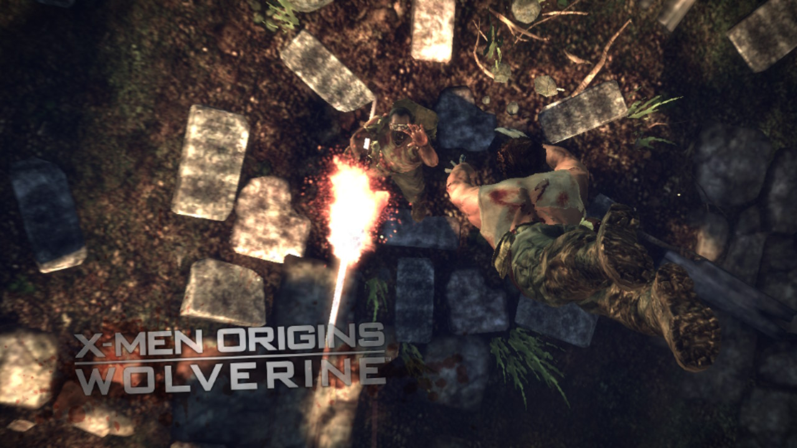

# XMOW-nx — X-Men Origins: Wolverine para Nintendo Switch

Port homebrew não oficial de **X-Men Origins: Wolverine – Uncaged Edition** para Nintendo Switch, a partir da edição de
Xbox 360. O ReXGlue recompila o código PowerPC do jogo para ARM64. A camada do app vem do
[gears2-nx](https://github.com/VasilkovND/gears2-nx): ela processa os comandos gráficos Xenos e desenha com Deko3D a
partir dos shaders traduzidos do próprio jogo.

> [!NOTE]
> **Release 0.1.34f: NRO pronto + instalador para Windows.** Não precisa compilar nem instalar Python. O instalador
> gera os arquivos do jogo e os shaders a partir do seu próprio disco. Veja [Instalar](#instalar) e
> [Reportar bugs](#reportar-bugs).

[Instalar](#instalar) · [Reportar bugs](#reportar-bugs) · [Estado atual](docs/estado.md) · [Como compilar](docs/build.md) · [Capturas](#capturas-no-switch) · [Referências](docs/referencias.md) · [English overview](#english-overview)

## Instalar

Na [release v0.1.34f](https://github.com/ramonDias07/XMOW-nx/releases/tag/v0.1.34f) há dois arquivos:
`XMOW-nx-v0.1.34f.zip` (NRO, `xmow.toml` e LEIA-ME) e `XMOW-nx-installer-v0.1.34f.zip` (instalador). O jogo não vem
incluído.

1. Extraia o instalador e rode `xmow_setup.exe` (Windows). Informe o seu `.iso` do disco de Xbox 360 (**Uncaged
   Edition**, sem title update) ou a pasta do disco já extraído, e uma pasta de saída. Ele extrai o jogo para
   `switch\XMOW\game_root` e gera os 4 arquivos de shader a partir do seu disco, conferindo cada um. Leva de 30 a 45
   minutos e precisa de uns 10 GB livres no PC. Nada é enviado para fora.
2. Copie para a raiz do cartão SD a pasta `switch` do `XMOW-nx-v0.1.34f.zip` e a pasta `switch` que o instalador criou.
   As duas vão para `/switch/XMOW/`.
3. Abra por um forwarder NSP (ou pelo Homebrew Menu em modo aplicativo): o port precisa da memória inteira de
   aplicativo.
O idioma segue o do console, como no Xbox 360 (o disco tem inglês, francês, espanhol e italiano; os outros ficam em
inglês). Menu rápido > LANGUAGE escolhe outro, depois de reiniciar o jogo.

## Reportar bugs

Bugs podem aparecer. Se achar um, abra uma [issue](https://github.com/ramonDias07/XMOW-nx/issues/new/choose) com o
seguinte, que é o que precisamos para corrigir:

1. Ligue o log: `L + R + →` > **LOGS AND DIAGNOSTICS** > **LOG LEVEL: INFO** (salve).
2. Repita o erro. Se for um problema de imagem, aperte `L3 + R3` na cena com o defeito.
3. Saia do jogo e pegue a pasta `/switch/XMOW/logs/` e o seu `xmow.toml`. Se o console inteiro travou ou mostrou uma tela
   de erro do Atmosphère, pegue também os arquivos com a data do erro em `/atmosphere/crash_reports/` e
   `/atmosphere/fatal_reports/`.
4. Na issue, diga a versão, a cena, o que aconteceu e o que você esperava, e anexe tudo num `.zip` (com uma foto ou
   captura da tela, se ajudar).

Depois, volte o LOG LEVEL para OFF para não perder desempenho.

## Estado do port

Build atual: **0.1.34f** ([release](https://github.com/ramonDias07/XMOW-nx/releases/tag/v0.1.34f), testada no Switch
físico). Mudanças desde a 0.1.16 em [release-v0.1.34f.md](docs/release-v0.1.34f.md).

| Área | Estado |
| --- | --- |
| Switch físico | A primeira fase é jogável do começo ao fim, com HUD, cutscenes, áudio e menus. |
| Desempenho | Cerca de 20 a 30 FPS com as configurações da release (resolução interna 75 %, GPU boost oficial). |
| Idioma | Segue o do console (inglês, francês, espanhol ou italiano); menu rápido > LANGUAGE escolhe outro. |
| Problema conhecido | Com LIGHTING NONE, o menu principal fica escuro ao voltar do gameplay, até a próxima fase carregar. |

## Compilar do código-fonte (opcional)

- Um dump `.iso` próprio do disco **X-Men Origins: Wolverine – Uncaged Edition (USA, Europe)** de Xbox 360, sem title
  update. O arquivo de entrada é `default.xex` com SHA-256
  `2f987f7ba3415bf9d1bc63bac3e671fd534eb33bb53878e816500c01bcd15378` (Title ID `41560816`).
- Nintendo Switch com acesso ao Homebrew Menu em modo aplicativo (ou um forwarder NSP) e um cartão SD com espaço para
  o disco extraído (cerca de 6,9 GB) e os shaders (cerca de 650 MB).
- Windows com Python, CMake, Ninja, LLVM-MinGW, DXC, devkitPro e o `rexglue` de host, como explica o
  [guia de build](docs/build.md).

O extrator copia o disco para `assets/game_root`. A recompilação e os shaders são gerados localmente a partir do seu
dump. A entrega fica em `out/sd/switch/XMOW/`, e o disco extraído vai em `game_root/` dentro dela.

## O que há no código

| Pasta | Conteúdo |
| --- | --- |
| `app/` | Camada do app (do gears2-nx, adaptada ao Wolverine), CMake do Switch, configuração `xmow.toml` e o manifesto do codegen com as funções extras do jogo. |
| `patches/` | Alterações do ReXGlue SDK NX (camada do gears2-nx e mudanças do XMOW), aplicadas sobre um commit fixo. |
| `tools/` | Preparação do SDK, extração do disco, codegen e passes sobre o código gerado, pipeline de shaders e build. |
| `docs/` | Guia de compilação, estado e histórico dos testes, referências. |

## No Switch

| Comando | Função |
| --- | --- |
| `+` e `−` juntos | Menu rápido do port (resolução de saída, GPU boost oficial, névoa de altura e outras opções). |
| `L + R + →` | Ajustes avançados (renderização, desempenho e diagnóstico). |
| `L3 + R3` | Captura de diagnóstico do próximo quadro (texturas resolvidas em `volcado_NN/` e trace no log). |

O port grava logs em `/switch/XMOW/logs/`. Shaders que faltarem na biblioteca vão para `shaders_dump/`.

## Capturas no Switch

Captura feita no Switch físico, numa build recente: as cutscenes já aparecem com imagem correta. O estado do gameplay está em [Estado atual](docs/estado.md).

## Contribuições

Testes no console, sugestões e pull requests são bem-vindos. Se você testar, conte a build, a cena e o que aparece na
tela, e anexe `logs/` e, se tiver, uma captura `L3 + R3`. Para propor uma correção de renderização, descreva o desenho
ou a passada afetada e, se possível, compare capturas antes e depois na mesma cena.
[Issues](https://github.com/ramonDias07/XMOW-nx/issues) · [Contribuidores](CONTRIBUTORS.md)

Se o projeto for útil, deixe uma estrela no GitHub para acompanhar o repositório.

## Créditos e referências

### Jogo original

- **X-Men Origins: Wolverine** foi desenvolvido pela **Raven Software** e publicado pela **Activision** (2009). A
  *Uncaged Edition* é a versão de Xbox 360 e PlayStation 3. O jogo usa a **Unreal Engine 3** da **Epic Games**.
- **Wolverine** e os **X-Men** são personagens da **Marvel**.

O jogo, os personagens, a arte, a música, as vozes e o design pertencem a essas empresas e às equipes que os criaram. Se
você gosta deste port, apoie as versões oficiais.

### Port e ferramentas

- **VasilkovND** pelo gears2-nx, a base deste port: camada do app, renderizador Deko3D sobre o SDK NX, patches do SDK,
  pipeline de shaders e passes do codegen. [gears2-nx](https://github.com/VasilkovND/gears2-nx)
- **Santiago Quiroz Upegui e colaboradores** pelo port de Gears of War 2 para PC, de onde vêm os passes de traps,
  barreiras de memória e *spin hints*, e **OverkillLabs3** pelo gears-judgement-recomp.
  [gears-of-war-2-pc-port](https://github.com/santiquiroz/gears-of-war-2-pc-port) · [gears-judgement-recomp](https://github.com/OverkillLabs3/gears-judgement-recomp)
- **Tom Clay, colaboradores do Xenia e nx-mod** pelo recompilador, runtime e suporte ao Switch.
  [ReXGlue](https://github.com/rexglue/rexglue-sdk) · [ReXGlue SDK NX](https://github.com/nx-mod/rexglue-sdk-nx)
- **panalexeu** pelo singularity-nx: o patch que desliga o *predicated tiling* no próprio jogo e 7 patches do SDK.
  [singularity-nx](https://github.com/panalexeu/singularity-nx)
- **nebadasSwifty** pelo masseffect-nx, base da busca de lacunas do codegen. [masseffect-nx](https://github.com/nebadasSwifty/masseffect-nx)
- **FurryLilManChild** e colaboradores pelo LoS1-nx, de onde vem o extrator XDVDFS. [LoS1-nx](https://github.com/FurryLilManChild/LoS1-nx)
- **hedge-dev**, **devkitPro**, **SwitchWakerHD** e **Khronos** pelas ferramentas usadas na tradução de shaders.
  [XenosRecomp](https://github.com/hedge-dev/XenosRecomp) · [uam](https://github.com/devkitPro/uam) · [SPIRV-Cross](https://github.com/KhronosGroup/SPIRV-Cross)

Veja de onde veio cada parte e o que é deste port em [Referências](docs/referencias.md).

## English overview

**XMOW-nx** is an unofficial Nintendo Switch homebrew port of **X-Men Origins: Wolverine – Uncaged Edition** from
Xbox 360. It uses ReXGlue for static recompilation and the app layer and Deko3D renderer of
[gears2-nx](https://github.com/VasilkovND/gears2-nx).

**Install (release v0.1.34f: ready NRO + Windows installer, no building, no Python):** the
[release](https://github.com/ramonDias07/XMOW-nx/releases/tag/v0.1.34f) has `XMOW-nx-v0.1.34f.zip` (NRO, `xmow.toml`,
readme) and `XMOW-nx-installer-v0.1.34f.zip`. The game is not included.
1. Extract the installer and run `xmow_setup.exe`. Give it your own Xbox 360 `.iso` (**Uncaged Edition**, no title
   update) or the extracted disc folder, and an output folder. It extracts the game to `switch\XMOW\game_root` and builds
   the 4 shader files from your disc, checking each one. It takes 30–45 minutes and about 10 GB free; nothing is uploaded.
2. Copy the `switch` folder from `XMOW-nx-v0.1.34f.zip` and the `switch` folder the installer made to the root of your SD
   card. Both go to `/switch/XMOW/`.
3. Open it through an NSP forwarder (or the Homebrew Menu in application mode): it needs the full application memory.

The game follows the console language (English, French, Spanish or Italian; anything else plays in English). Quick menu
(`+` and `−` together) > LANGUAGE picks another one after a restart.

**Reporting bugs:** bugs can show up. Please open an [issue](https://github.com/ramonDias07/XMOW-nx/issues/new/choose):
turn the log on (`L + R + →` > LOGS AND DIAGNOSTICS > LOG LEVEL: INFO), repeat the problem (press `L3 + R3` on a visual
glitch), then attach a `.zip` with `/switch/XMOW/logs/`, your `xmow.toml` and, if the whole console crashed, the files
from that time in `/atmosphere/crash_reports/` and `/atmosphere/fatal_reports/`. Say the version, the scene and what
happened. Set LOG LEVEL back to OFF afterwards.

Building from source is still possible: [build guide in Portuguese](docs/build.md) · [Test history](docs/estado.md)

**Original game and legal notice.** *X-Men Origins: Wolverine* was developed by **Raven Software** and published by
**Activision**. Wolverine and the X-Men are **Marvel** characters. Unreal Engine is a trademark of **Epic Games**. This is
a non-commercial fan project. It is **not affiliated with or endorsed by** Activision, Raven Software, Marvel, Disney,
Epic Games, Microsoft or Nintendo. No game files, shaders or keys are distributed: the installer makes them from your
own disc. You must own the original disc and make your own dump. Rights holders with a concern can open an issue, and the material will be reviewed or removed
promptly.

## Aviso legal

Este é um projeto de fãs, não oficial e sem fins lucrativos. **Não tem afiliação, patrocínio nem aprovação** da
Activision, Raven Software, Marvel, Disney, Epic Games, Microsoft ou Nintendo.

- *X-Men*, *Wolverine* e os personagens relacionados são marcas e obras protegidas da Marvel. O jogo é © Activision.
  *Unreal Engine* é marca da Epic Games.
- *Xbox 360* é marca da Microsoft Corporation e *Nintendo Switch* é marca da Nintendo. Os nomes aparecem aqui só para
  indicar compatibilidade.
- Este projeto **não distribui** o jogo, seus arquivos de dados, áudio, vídeo, texturas, shaders nem chaves. O
  instalador gera os arquivos do jogo e os shaders a partir de um disco original adquirido legalmente e de um dump feito
  pela própria pessoa. Não peça nem compartilhe ISOs nem arquivos do jogo.
- Titulares de direitos com alguma objeção podem abrir uma [issue](https://github.com/ramonDias07/XMOW-nx/issues). O
  material será revisto ou removido prontamente.

## Licenças

O código deste port segue a GPL-3.0, a mesma do gears2-nx. Os componentes de terceiros mantêm suas licenças em
[`licenses/`](licenses/) e nas próprias árvores. A GPL-3.0 vale apenas para o código deste repositório e não cobre o
jogo original nem os dados extraídos dele. O dump, os arquivos do jogo, os shaders e caches derivados e os saves ficam
no computador e no cartão de quem instala. O instalador (`tools/installer/`) também é GPL-3.0, e as licenças das
ferramentas que ele embute estão no próprio pacote.
